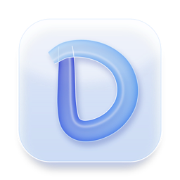
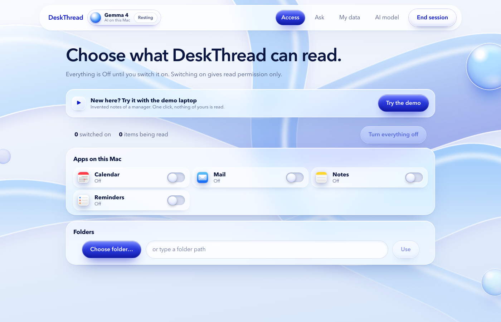

<p align="center"></p>
<h1 align="center">DeskThread</h1>
<p align="center"><b>Find what you wrote down. Your notes never leave your laptop.</b></p>

<p align="center">
<a href="https://deskthread.vercel.app"><b>Download for Mac</b></a> ·
<a href="https://youtu.be/0CBEZsb4PlA">Demo video</a>
</p>

<p align="center"></p>

## What it is

A native **Mac app** that finds what you wrote down in Notes, Calendar, Mail, Reminders and your folders.
Every answer shows the exact quote, the date and where it came from. If the answer is not there, it says "not found".

- **Local:** the AI runs on your Mac. No accounts, no telemetry.
- **Read only:** everything starts Off. You switch on what it may read.
- **No copies:** the app writes nothing to disk.

Prototype for macOS on Apple silicon. All sample data is invented. Windows is not tested.

## How it is built

```
Mac window (WebKit)  ->  Page (React, static)  ->  Backend (Python, 127.0.0.1)  ->  Model server (Ollama, 127.0.0.1)
                                                        |
                                    Gates: G1 what may be read -> G2 read -> G3 model -> G4 answer check
                                                        |
                                  Your files and Mac apps (read only, held in memory)
```

| Part | What it does |
|---|---|
| **Window** | A native Mac window. No browser, nothing kept on disk |
| **Page** | The screens: Access, Ask, My data, AI model |
| **Backend** | Reads what you allowed, finds notes, checks every answer. Connects to `127.0.0.1` only |
| **Model** | `gemma4:e4b`, run locally. It names a note and a line; code copies the quote |

More in [How it works](docs/how-it-works.md).

## Try it

```bash
git clone https://github.com/Rylie-KIM/deskthread-app.git && cd deskthread-app
brew install ollama uv
make setup ui demo-data
make run
```

Then click **Try the demo** and **Prepare**. Full steps: [Install and run](docs/install-and-run.md).

## More

| | |
|---|---|
| [Status](docs/status.md) | What is built and what is not |
| [Privacy and how to check it](docs/privacy-checks.md) | The promises, and how you can verify each one |
| [Install and run](docs/install-and-run.md) | Requirements, steps, terminal use |
| [How it works](docs/how-it-works.md) | Parts, gates, project structure |
| [Tests](docs/tests.md) | What the tests prove |
| [Test report](docs/test-report.md) | The run of 23 Nov 2026, with results |
| [Traceability](docs/traceability.md) | User need → feature → test |
| [Demo data and limits](docs/data-and-limits.md) | The invented data, known limits |
| [Dependencies](docs/dependencies.md) | Every dependency and its licence |

Prototype built for a hackathon in November 2026. No licence chosen yet.
