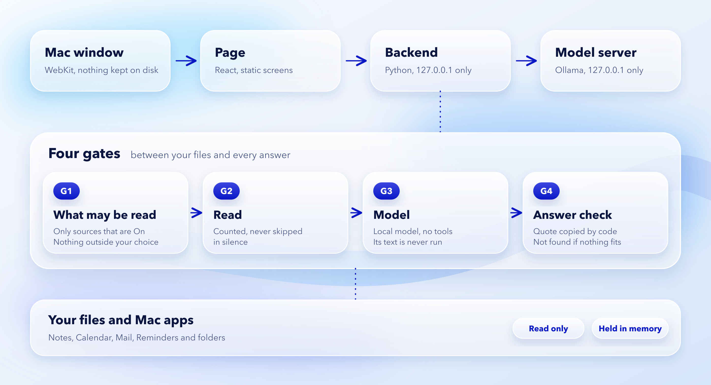

<p align="center"></p>
<h1 align="center">DeskThread</h1>
<p align="center"><b>Find what you wrote down. Your notes never leave your laptop.</b></p>

<p align="center">
<a href="https://deskthread.vercel.app"><b>Download for Mac</b></a> ·
<a href="https://youtu.be/0CBEZsb4PlA">Demo video</a>
</p>

<p align="center"></p>

## Problem

Managers keep their work notes in many places: Notes, Calendar, Mail, Reminders and folders. Before a meeting, finding what was promised or decided means searching each one. Cloud assistants could help, but sending work notes outside the laptop is often not allowed.

DeskThread is a native **Mac app** that finds what you wrote down in Notes, Calendar, Mail, Reminders and your folders.
Every answer shows the exact quote, the date and where it came from. If the answer is not there, it says "not found".

- **Local:** the AI runs on your Mac. No accounts, no telemetry.
- **Read only:** everything starts Off. You switch on what it may read.
- **No copies:** the app writes nothing to disk.

Prototype for macOS on Apple silicon. All sample data is invented. Windows is not tested.

## Main user needs and features

| User need | Main features |
|---|---|
| Recall what I promised before a one-to-one, and prepare for the next meeting | Brief, "Prepare my next meeting" |
| See the exact words, the note and the date behind every answer | Quote and source viewer, coverage view (which files were read) |
| Open the original behind a quote, in its own app | "Show in" Finder, Notes, Reminders or Calendar |
| See how an answer was reached, and open every number | "How this was checked": a funnel, the model's name, "Left out" |
| Find related notes that do not name the person, apart from the confirmed ones | Search by meaning and by time, "Possibly related" |
| Get an honest "not found" instead of an invented answer | Answer gate: every quote is checked, "not found" when nothing fits |
| Choose what it can read, and take it back at once | Sources Off by default, one-click access, instant revoke, off-limits list |
| Cover where I keep work information | Notes, Calendar, Mail, Reminders, folders and image readers |
| Be sure my notes stay on my laptop, and check it myself | Local model, no files written, My data with "Check it now", Clear memory, End session with a receipt |
| Use it like any app, stop a long question, choose the AI | One-click launcher, native Mac window, "Choose folder..." button, Stop, AI model page with eight models |
| Choose how far back Calendar and Mail are read | Period: most recent weeks to a year, or exact dates |

Every need, feature and test (29 needs) is linked in [Traceability: user need → feature → test](docs/traceability.md). It also lists what was planned and is **not built yet**: confirming each item by hand, an independent `verify` script and an operating-system sandbox.

## Structure of the app

<p align="center"></p>

Project directories (the files of the repository, not the data it reads):

```
deskthread-app/
├── DeskThread.app/
├── DeskThread.command
├── app/                       the backend
│   ├── policy.py              G1  what may be read
│   ├── sources/               G2  folder and Mac app connectors, read only
│   ├── readers/               G2  one reader per file type
│   ├── model.py               G3  the only code that talks to the local model
│   ├── gate.py                G4  the answer check
│   ├── broker.py              permissions: one switch to allow, the same to stop
│   ├── search.py              finding notes with no stored index
│   ├── meaning.py             related notes by meaning, with the EmbeddingGemma search helper
│   ├── assistant.py           one question, end to end
│   ├── store.py               what the session holds in memory
│   ├── api.py                 the only door between the page and the backend
│   ├── images.py              reading pictures: macOS text recognition first, the AI only where none is found
│   ├── ocr.py                 macOS's own text recognition (Apple Vision), run on this Mac
│   ├── meetings.py
│   ├── period.py
│   ├── window.py
│   └── proof/                 evidence, memory, End session and its receipt
├── ui/                        the page: Access, Ask, My data, AI model
│   ├── pages/
│   └── components/
├── contracts/                 data shapes and interfaces shared by all parts
├── demo-data/                 generator of the invented laptop
├── eval/                      ground truth, questions, scorer, model comparison
├── tests/
├── scripts/
├── docs/
├── site/
├── Makefile
└── pyproject.toml, uv.lock
```

| | |
|---|---|
| [How it works](docs/how-it-works.md) | Parts, gates, project structure. The model (`gemma4:e4b`, run locally) only names a note and a line; plain code copies the quote |

## Local helpers: reading pictures and finding by meaning

Two small helpers sit beside the answering AI. Neither one answers questions.

| | Reading pictures | Finding by meaning |
|---|---|---|
| What it is | macOS's own text recognition (Apple Vision) | EmbeddingGemma by Google, a small search model (0.6 GB) |
| What it does | Reads the text in a screenshot or photo. The AI looks only at pictures where macOS finds no text | Turns each note into numbers, so notes that say similar things are found even in other words |
| What it adds to an answer | A quote from a picture can be cited like any note | "Possibly related" notes that do not name the person, shown apart from the confirmed points |
| Where it runs | On this Mac | On this Mac |
| What it keeps | Nothing: the text stays in memory | Nothing: the numbers stay in memory and are dropped on Clear memory and End session |
| If it is missing | The AI reads the pictures instead | Search works by words only |

Tested on typed screenshots; handwriting and poor photos were not tested.

## How to install the application

```bash
git clone https://github.com/Rylie-KIM/deskthread-app.git && cd deskthread-app
brew install ollama uv
make setup ui demo-data
make run
```

Then click **Try the demo** and **Prepare**.

| | |
|---|---|
| [Install and run](docs/install-and-run.md) | Requirements, steps, terminal use |

## Tests

`make check` runs lint, strict type checks and **184 automated tests** in about 13 seconds, without the model. All pass (24 Nov 2026; the [test report](docs/test-report.md) of 23 Nov lists 180).

| What is checked | Result |
|---|---|
| Access and consent: sources start Off, off-limits files are never opened, access can be taken back at once | pass |
| Privacy: the app connects to `127.0.0.1` only, writes nothing to disk, keeps nothing after End session | pass |
| Answers: invented citations are dropped, instructions hidden in a note are ignored, "not found" when nothing fits | pass, with a scripted fake model |
| Evaluation with the real model on the invented laptop | **5 of 8** (65 files) and **4 of 8** (143 files) |
| Model comparison: three installed models and a no-model baseline | best model about 5 of 8, plain search 2 of 8 |

The answer quality is still being worked on. Not yet done: a canary leak test on the whole flow, and the Ask and My data screens have not been re-checked by hand since the redesign.

| | |
|---|---|
| [Tests](docs/tests.md) | What the tests prove, group by group |
| [Test report](docs/test-report.md) | The run of 23 Nov 2026, with results |
| [Model comparison](docs/model-comparison.md) | Three models and a no-model baseline, measured |

## Demo

In the app, click **Try the demo**. It opens an invented laptop: a fictional company, a manager and a team of four. No real notes are used, and the expected answers are kept outside the folder the app can read.

| | |
|---|---|
| [Demo data and limits](docs/data-and-limits.md) | The invented data, known limits |

## Documented files

| Document | What it covers |
|---|---|
| [Status](docs/status.md) | What is built and what is not |
| [Privacy and how to check it](docs/privacy-checks.md) | The promises, and how you can verify each one |
| [Traceability](docs/traceability.md) | User need → feature → test |
| [How it works](docs/how-it-works.md) | Parts, gates, project structure |
| [Install and run](docs/install-and-run.md) | Requirements, steps, terminal use |
| [Tests](docs/tests.md) | What the tests prove, group by group |
| [Test report](docs/test-report.md) | The run of 23 Nov 2026, with results |
| [Model comparison](docs/model-comparison.md) | Three models and a no-model baseline, measured |
| [Demo data and limits](docs/data-and-limits.md) | The invented data, known limits |
| [Dependencies](docs/dependencies.md) | Every dependency and its licence |

Prototype built for a hackathon in November 2026. No licence chosen yet.
